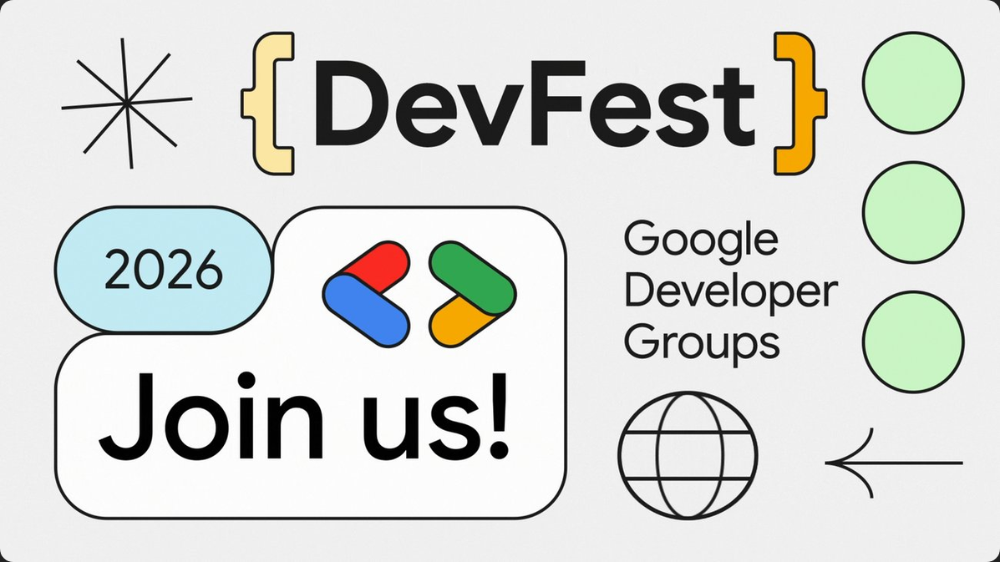
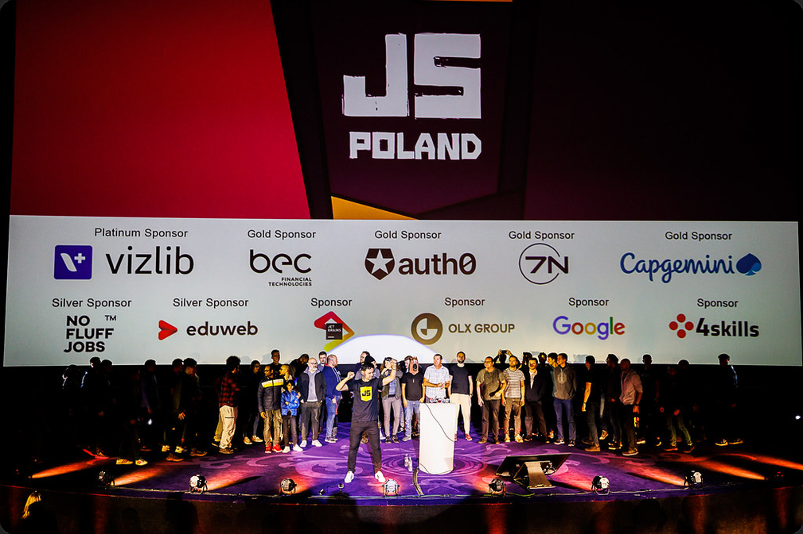
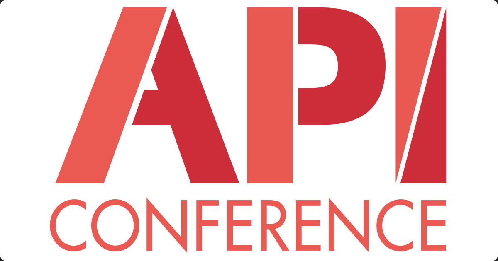
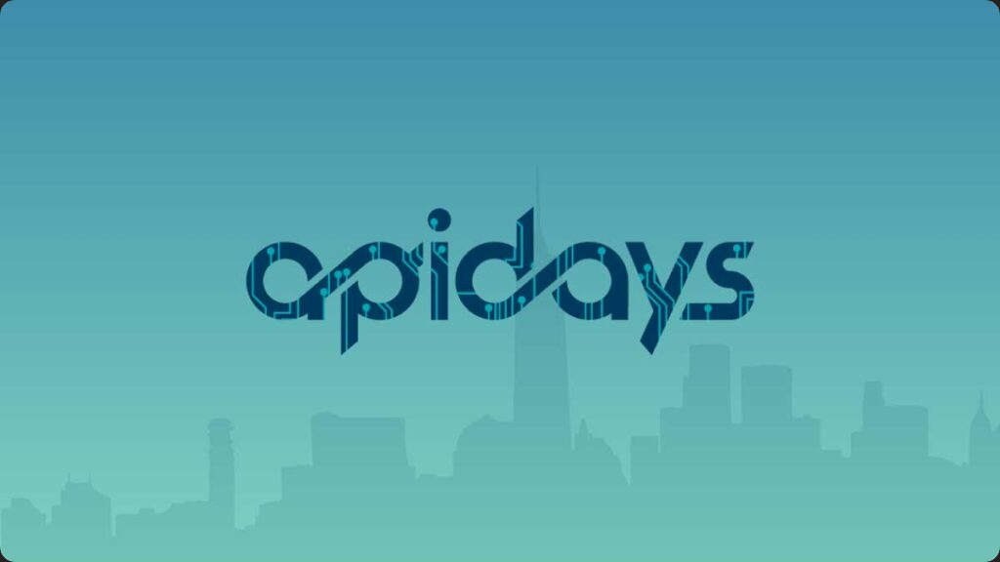

# Dev Events - November and December 2026

## Devfest Berlin 2026

#### Website

[Devfest Berlin](https://2026.devfest-berlin.de/)

#### Where

Berlin, Germany

#### Dates

14 November

#### Description

Join us for the DevFest Berlin 2026, where we will dive into the exciting plans for the upcoming festival. This is a fantastic opportunity to network with fellow developers, share ideas, and get a sneak peek at what's to come in 2026. Space is limited, so be sure to RSVP today and be part of shaping the future of tech in Berlin!

#### First track - DevFest Berlin Hackathon - Speaker and agenda

[Speakers and Agenda](https://2026.devfest-berlin.de/agenda/)

#### Second track - Devfest Vibe Lounge - Speaker and agenda

[Speakers and agenda](https://2026.devfest-berlin.de/agenda/#vibe-lounge-schedule)

#### Event topics

The event includes 5 themes with many topics ranging from current practice to innovation

Themes:
- AI and Machine Learning technologies and models
- Cloud platforms and infrastructure management
- Software Languages and Mobile development
- Developing in teams, beyond software and into product
- Robotics and Hardware such as the Internet of Things

More details can be found in both agendas:
[Speakers and Agenda](https://2026.devfest-berlin.de/agenda/)
[Speakers and agenda](https://2026.devfest-berlin.de/agenda/#vibe-lounge-schedule)

 
 
 

## Js Poland

#### Website

[Js Poland](https://js-poland.pl/)

#### Where

Warsaw, Poland and Online

#### Dates

18 November

#### Description

Js Poland brings talks and workshops about Javascript in the Browser, topics include advanced application management for performance, robustness and interpretable errors, Nodejs as an engine for the web and AI for the web

#### Top speakers

- Julien Huang, Software engineer, Nuxt Core Team
  
- Julian Burr - Senior software developer, Sonar AI
  
- Nikola Rokvić - Software engineer, Google
  
- Raúl Jiménez - Cofounder of GolemUI
  

#### Event highlights

- Javascript in the browser
  
- Node as a Javascript engine
  
- Integrating Agents in the web
  
  A full agenda can be found here:
  
  [Js Poland agenda](https://js-poland.pl/#schedule)
  
  If it doesn't show on the first click, please scroll below
  
 
 
 

## API Conference

#### Website

[API Conference](https://apiconference.net/berlin-de/)

#### Where

Berlin, Germany

#### Dates

16-17 and 20 November

18 and 19 November

#### Description

API Conference brings together architects, developers and technology leaders explaining in 1 hr sessions across many days and workshops modern APIs, connecting, using them and governance in the new technological era

#### Top speakers

- Mike Amundsen - Author Speaker Trainer - Amundsen - API Architecture, Digital Transformation

- Thomas Bayer - API Consultant, Managing director, predic8

- Matthias Biehl - API Innovation Strategist and Author

- Dino Esposito - Microsoft MVP

- Michael Hablich - Product Manager, Google

#### Event highlights

- AI Trustworthy by Design, AI Governance Standards - David Roidàn Martinez, Indipendent Consultant

- Governance in the Age of AI Agents - Frederick Elewaut, Axway

- Many Workshops 

- Hands-On Bootcamp: Vibe Coding and GenAI development day 1

- Hands-On Bootcamp: Vibe Coding and GenAI Development Day 2

 
 
 

## JS Nation - New York

### Website

[JSNation](https://jsnation.us/)

#### Where

New York, US and online

#### Dates

16-17 and 19 November

#### Description

JS Nation brings deep dives in fullstack development and architecture on the web, senior engineer and technical leader counselling and the newest developments of AI engineering and AI assisted coding, not only models

#### Top speakers - if short speaker list

- Wes Bos - Syntax fm
  
- Cole Medin - Dynamous
  
- Joshua Lochner - Hugging Face
  
- Alex Russell - Microsoft
  
- Rachel White - Datadog
  

#### Event highlights

- WebMCP: Clicks and Clankers - Wes Bos
  
- Build your AI Second Brain in Typescript - Cole Medin
  
- Agentic kernel Optimization at the Scale of the Web - Joshua Lochner
  
- Groundhog Day: A Decade in the Web Performance Trenches - Alex Russell
  
- Everything is Fine: A Brief History of Javascript Security - Rachel White
  
- Taming the Web AI Beast With Google's LiteRT.js: Seeing, Hearing, and Thinking in Javascript - Ping Yu
  
- Slopbowlification of Software - Aayush Kapoor
  
- Frontend's Existential Crisis, Revisited - Ryan Carniato
  
- Frontend Beyond the Screen: Where AI Agent Is A User - Maya Shavin
  
- ECMAScript, Classified - Hemanth HM
  
- Ship a Next.js App with Claude Code - Maurice de Beijer
  
- AI-Native Product Engineering - Kent C. Dodds
  
- The Vulnerabilities Hiding in Your AI Workflow - Aviv Keller
  
- Look Ma, No Hands! Multimodal AI-Agents in the Browser - Nico Martin
  
- Instrumentation Without the Tax: Native Tracing Channels in Node.js - Abdelrahman Awad
  
   
   
   

## Apidays - Paris

#### Website

[Apidays Paris](https://www.apidays.global/events/paris)

#### Where

Paris - CNIT Forest, Paris

#### Dates

1 - 3 December

#### Description

- AI Safety, governance and sustainability
  
- Incident and success stories from companies innovating
  
- Many Workshops
  
- API economy and governance in the new technological era
  
- Open source topics
  
- Marketing strategies in the new technological era
  
- Ecofriendly technology and infrastructure
  

#### Top speakers

- Françoise Soulié - Scientific advisory, Hub France IA
  
- Hugo Duminil-Copin - Mathematician, IHES
  
- Laura Operti - Artist
  
- Lea Deleris - Head of AI Robotics and Tech, BNP Paribas
  
- Simeng Yang - Technical staff, OpenAI
  
  And 100+ more ...
  

#### Event highlights

A mix of themes and topics presented in native french and english, the agenda is very dense with hundreds of sessions, you can find a full agenda here:
[Apidays Paris - Agenda](https://www.apidays.global/events/paris#agenda)

 
 
 

